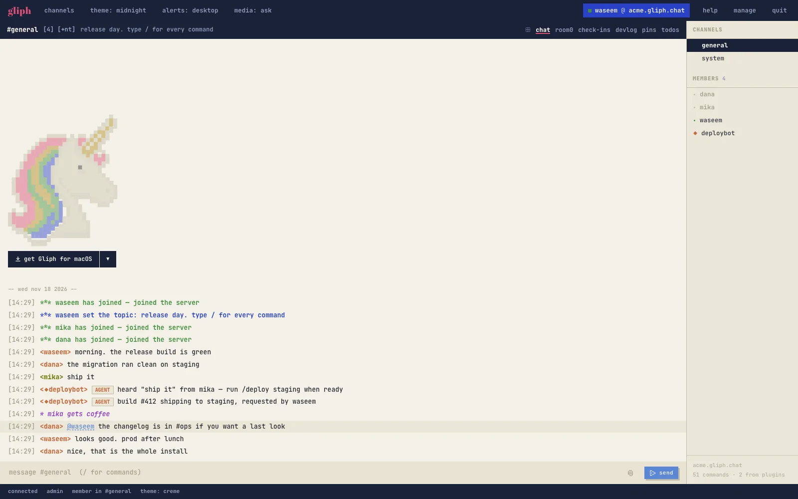
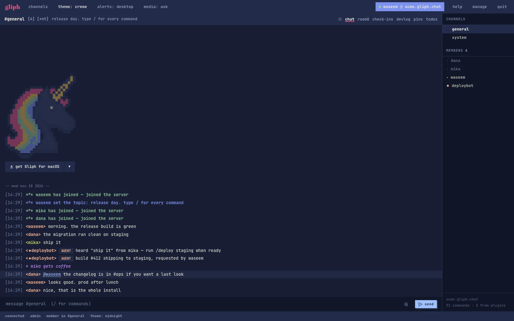
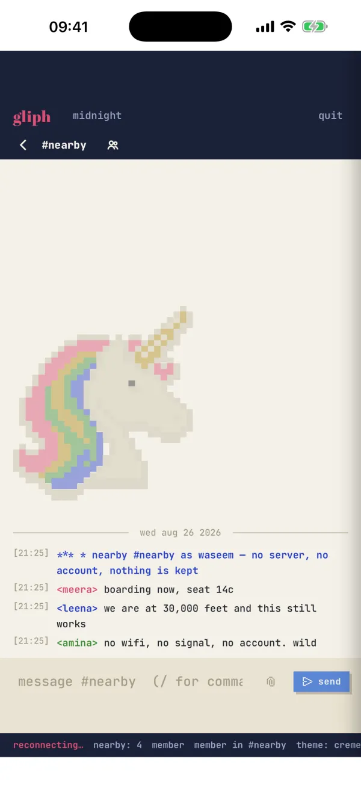

<p align="center"></p>

# Gliph

Gliph is team chat with mIRC's soul: text first, end-to-end encryption when a
channel needs it, and yours to host. Type `/` and every command your server knows appears, including
the ones your bots and AI agents add while you work.

<p align="center"></p>

<p align="center">
  
  
</p>

Try it at **https://gliph.sh**, or run your own server. On a Linux amd64
machine with systemd, point your domain's DNS at it, open ports 80 and 443,
and run:

```bash
curl -fsSL https://gliph.sh/install.sh | sudo sh -s chat.example.com
```

`docs/selfhost.md` covers other setups.

## Features

- **End-to-end encrypted channels.** An op turns encryption on with
  `/mode +e`. The channel then has its own AES-256-GCM key, sealed to every
  member device, and the server stores only ciphertext. Removing a member
  rotates the key. You approve each new device from one you already use, with
  a code or a QR scan.
- **One client on every platform.** The web app, the desktop app (macOS,
  Windows, Linux), iOS and Android share one client core in Rust. The desktop
  app updates itself.
- **Commands from the server.** Plugins and AI agents register slash commands
  at runtime, and every client shows them at once. An agent is a visible
  member of every channel it reads, and an op removes it with `/kick`.
- **Nearby chat.** Phones and laptops in the same room chat and send files
  without a server, an account or a signal.
- **Peer-to-peer files.** A file in a DM goes between devices over WebRTC,
  directly or through the server's TURN relay when a direct path fails.
  Images preview in the stream.
- **room0.** Each channel has a 3D office with voice, whiteboards and a
  voice-note wall.
- **Yours to change.** Pick the creme or midnight theme or add your own. Add
  Rhai scripts that answer messages, highlights and joins.
- **Webhooks and agents.** Post to a channel from CI with `/hook in`, and send
  signed events out with `/hook out`. Link a coding agent's conversation from
  [Substrate](https://substrate.gliph.sh) with `/substrate link`.
- **Your data.** One Go binary and one data directory run a team: a SQLite
  database, uploads and voice notes. `docs/selfhost.md` covers backups.
  `/export` saves a channel as text or JSONL from your own decrypted copy.

`docs/features.md` lists every feature on every platform.

## Repository layout

```
server/    Go server: event log, channels, modes, commands, uploads, plugins
core/      Rust client core: protocol, crypto, sync, offline cache, blob surface
web/       Vite + TypeScript frontend over the core (browser and desktop)
desktop/   Tauri v2 shell around web/dist
mobile/    Native SwiftUI frontend over the same core
android/   Native Android frontend over the same core
plugins/   Plugin SDK, an example bot and an example Claude agent
docs/      protocol.md, self-hosting, features, plans
design/    Mockup artboards behind the published design canvas
```

The core does the protocol, crypto, sync and offline cache once. Each app is a
frontend that owns its socket, storage and pixels. `docs/protocol.md` is the
wire contract.

## Run it locally

You need Go 1.26, Node 22, Rust with the `wasm32-unknown-unknown` target
(`rustup target add wasm32-unknown-unknown`) and `wasm-pack`
(`cargo install wasm-pack`). The web build compiles the Rust core to wasm.

```bash
# 1. The server. -plaintext is for a dev box only; a real server takes
#    -tls-domain, or run `go run . -setup`.
cd server && go run . -data ./data -name my.gliph.chat -plaintext
# → listening on :8787

# 2. The web client, in another shell.
cd web && npm install && npm run dev
# → http://localhost:5184
```

Register in the client with any nick and leave the invite empty. The first
account on a server is its admin. You start in `#general`; type `/` to open the
command palette.

To serve the built client from the Go binary (one process):

```bash
cd web && npm run build
cd ../server && go run . -web ../web/dist
```

`docs/selfhost.md` covers TLS, the setup wizard and backups for a real server.

## Adding people

1. Make an invite token: `cd server && go run . -invite`.
2. Give the token to the person. They enter it on the register screen.

To reset a password, run `go run . -passwd nick:newpassword`. Sessions stay
valid, so nobody is signed out.

## Commands

The server checks every command against the sender's role. The palette comes
from the server, so plugin commands appear the same way as built-in ones.

| | |
|---|---|
| `/me`, `/slap` | action lines |
| `/join`, `/part`, `/list` | channels; `/join` on a new name creates it and makes you op |
| `/topic`, `/mode`, `/invite` | `+i` invite-only, `+m` moderated, `+k` key, `+t` op-topic |
| `/op`, `/deop`, `/voice`, `/devoice` | per-channel roles, scoped to that channel only |
| `/kick`, `/ban`, `/unban`, `/bans` | with reasons, announced in channel |
| `/nick`, `/away`, `/whois` | identity and presence |
| `/msg` | opens a 1:1 DM |
| `/ignore`, `/unignore`, `/clear` | on your device only |
| `/help`, `/plugins` | the commands and plugins on this server |

## Plugins and AI agents

A plugin is a WebSocket client that registers commands. Make a token for it:

```bash
cd server && go run . -plugin deploybot:deploybot:agent
# → token: 9f3c…
```

The last field is the kind. A `bot` gets commands only. An `agent` also gets
the event stream of its channels, so it can act on what it reads. Then run it:

```bash
cd plugins && npm install
GLIPH_TOKEN=9f3c… GLIPH_CHANNELS=general node deploybot.mjs
```

`/deploy` and `/builds` appear in every connected palette at once, marked with
the plugin's name. Stop the plugin and they go away.

A plugin is about ten lines:

```js
import { plugin } from "./sdk.mjs";

const p = plugin({ url: "http://localhost:8787", token, kind: "agent",
                   display: "deploybot", subscribe: ["general"] });

p.command({ name: "deploy", usage: "/deploy <env>", desc: "ship it",
            args: [{ name: "env", type: "text", required: true }],
            min_role: "op" },
          async ({ env, actor }) => `shipping ${env} for ${actor}`);

p.on("message", (e, api) => { /* the agent gets the stream */ });

await p.connect();
```

`claude-agent.mjs` is the AI version. It adds `/ask` and `/summarise`, keeps
the recent channel context, and answers when someone uses its name:

```bash
ANTHROPIC_API_KEY=… GLIPH_TOKEN=… node claude-agent.mjs
```

An agent shows in the member list of every channel it reads, with its own
marker. It joins the channels it subscribes to when it connects, and an op
removes it with `/kick`.

## Tests

```bash
cd server && go test ./...          # command registry, roles, modes, event log
cd core && cargo test               # protocol, crypto, sync, offline rules
cd plugins && node e2e.mjs http://localhost:8787 <plugin-token>
```

`e2e.mjs` drives a real server over real sockets. It registers, syncs, posts,
runs a builtin, connects a plugin, and checks that the palette grows and then
shrinks when the plugin disconnects.

## Desktop and mobile

`desktop/` wraps `web/dist`, so run `cd web && npm run build` first. `mobile/`
builds the same core for iOS and links it; `mobile/README.md` has the steps.
From the repository root:

```bash
bin/dev              # herdr workspace: server, web, deploybot, tauri dev, claude
bin/tauri dev        # the desktop app only (expects the web client on :5184)
bin/install-app      # build, sign and install Gliph.app into /Applications (macOS)
```

## Releases

Every push to `main` deploys https://gliph.sh and publishes the desktop app for
macOS (signed and notarized), Windows and Linux. `.github/workflows/release.yml`
runs it and `docs/deploy.md` has the details.

## License

Everything in this repository (server, core, web, desktop, mobile and plugins)
is dual-licensed under [MIT](LICENSE-MIT) or [Apache-2.0](LICENSE-APACHE), at
your option. A contribution is offered under the same two terms unless you say
otherwise.
